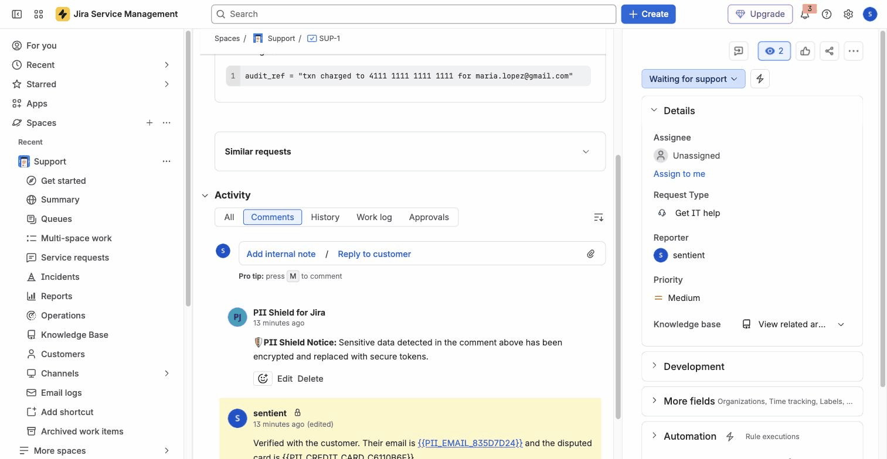
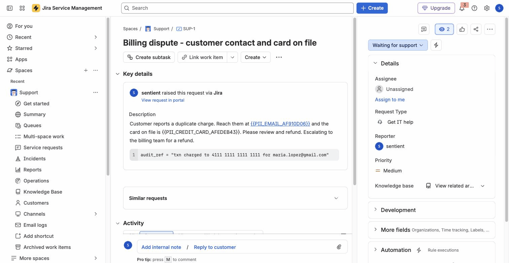
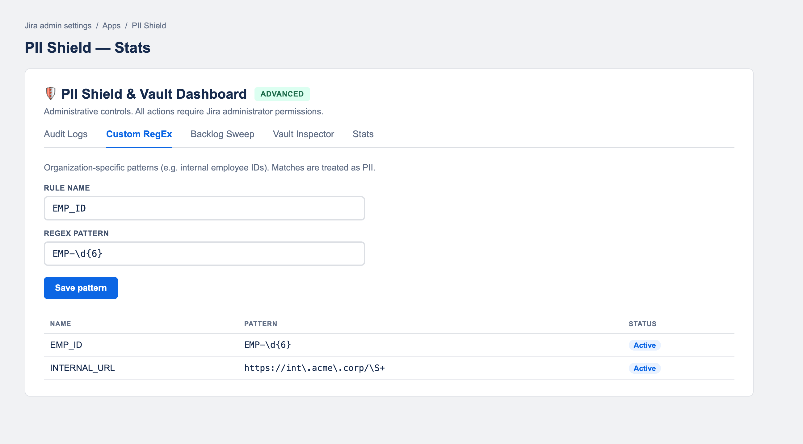
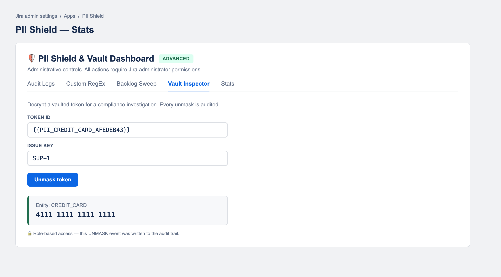
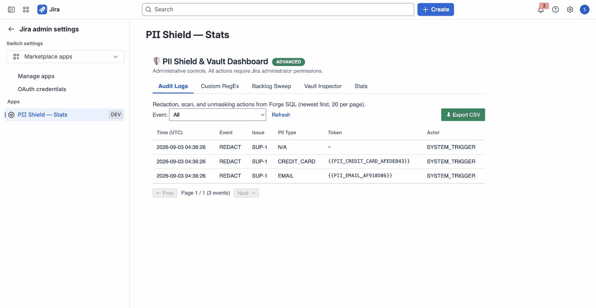

# PII Shield – User Documentation & Security Policy

**Developed by SentientApps** *Empowering Jira Admins with privacy-first automated security.*

---

## 🛡️ Overview
**PII Shield for Jira** automatically detects and redacts Personally Identifiable Information (PII) and secrets from Jira **comments, issue descriptions and fields, and text attachments** — replacing them in place with secure, reversible tokens. It runs **100% natively on Atlassian Forge** and is designed for high-compliance environments (GDPR, CCPA, SOC 2).

## 🎬 Demo Video
A short walkthrough of PII Shield in action — real-time comment redaction, field & code-block-aware redaction, custom rules, the audit trail, and authorized unmasking:

▶️ **[Watch the demo (MP4)](media/pii-shield-demo.mp4)**

## 📸 Screenshots

**Real-time comment redaction** — sensitive data is replaced with secure tokens and a notice is posted automatically.

**Issue field & description redaction** — PII is tokenized while code blocks are preserved.

**Custom RegEx rules** — define your own organization-specific detection patterns.

**Vault Inspector** — authorized admins unmask a token for a compliance investigation; every unmask is audited.

**Exportable audit logs** — evidence for SOC 2 and GDPR review.

## 🚀 How to Access the App
Once installed from the Atlassian Marketplace:
1. **Real-time protection** runs automatically on comments, descriptions, and fields as they are created or updated — no configuration required.
2. **Admin dashboard:** go to **Jira Settings → Apps → PII Shield** to reach the *PII Shield & Vault Dashboard*.

## 🛠️ How it Works
PII Shield scans text in real time and, when it finds sensitive data, encrypts it and replaces it with a token such as `{{PII_EMAIL_2D2D363E}}`. A short notice is posted so the team knows sanitization occurred.

**Detected out of the box:**
* **Email addresses**
* **Credit-card numbers** (Luhn-validated)
* **Technical secrets / API keys** — AWS, Stripe, GitHub, Google, Slack, Twilio, SendGrid, npm, and Bearer tokens
* **Custom patterns** — any regular expression you add under **Custom RegEx**

**Descriptions & fields** are redacted while **code blocks are preserved**, so developer snippets and logs stay intact.

### Admin Dashboard
* **Audit Logs** — every redaction, scan, and unmask, exportable to CSV for SOC 2 / GDPR evidence.
* **Custom RegEx** — add organization-specific patterns (e.g. `EMP-\d{6}`); every match is treated as PII.
* **Backlog Sweep** — tokenize legacy PII across a project's existing issues.
* **Vault Inspector** — an authorized admin can unmask a token for an investigation; every unmask is audited.
* **Stats** — redaction metrics.

---

## 🔒 Security Policy
The following sections outline our commitment to data protection and our "Zero-Egress" architecture.

### Atlassian Forge Infrastructure
PII Shield is built exclusively on the **Atlassian Forge** platform. The app operates within a multi-tenant, serverless environment managed and secured by Atlassian, inheriting Atlassian's enterprise-grade security controls, including built-in authentication, scoped permissions, and data isolation.

### Zero-Egress Architecture
* **No external data transfer:** No end-user data — Jira issue content, comments, attachments, or metadata — is ever transmitted to or stored on servers outside Atlassian. The app declares **no external egress** in its manifest, and Forge enforces this.
* **In-platform processing:** All detection and redaction logic runs inside the Atlassian Forge FaaS environment. The app uses **no third-party subprocessors**.

### Data Storage & Retention
* **Stored within Atlassian only** — using Forge Key-Value Store and Forge SQL. No external database.
* **Encrypted vault:** so that redactions can be reversed by an authorized admin, the original value is encrypted with **AES-256-GCM** and stored as **ciphertext**, keyed to its token. **Plaintext PII is never stored** — only ciphertext, unmaskable solely by an admin with the appropriate role.
* **Metadata & audit** (redaction counts, and an audit trail of event type, token, issue key, timestamp, and actor) are stored in Forge storage and contain no plaintext PII.
* **Deletion:** all app data is removed when the app is uninstalled, per Atlassian's Forge data-lifecycle handling.

### Encryption
* **In transit:** TLS, within the Atlassian platform.
* **At rest:** AES-256-GCM for vaulted values, on top of Atlassian's own storage encryption.

### Vulnerability Reporting
If you discover a potential vulnerability, please report it via our [Issue Tracker](https://github.com/bandi29/pii-shield-support/issues) or by emailing **apps@sentientapps.io**. We aim to acknowledge security reports within 24 business hours.

---

## 📞 Support & Feedback
* **Support Email:** [apps@sentientapps.io](mailto:apps@sentientapps.io)
* **Marketplace Listing:** [PII Shield for Jira on the Atlassian Marketplace](https://marketplace.atlassian.com/apps/1513204054/pii-shield-for-jira)
* **Bug Reports:** open an issue on our [GitHub Support Repository](https://github.com/bandi29/pii-shield-support).

---
*© 2026 SentientApps. Built for the Atlassian Marketplace.*
