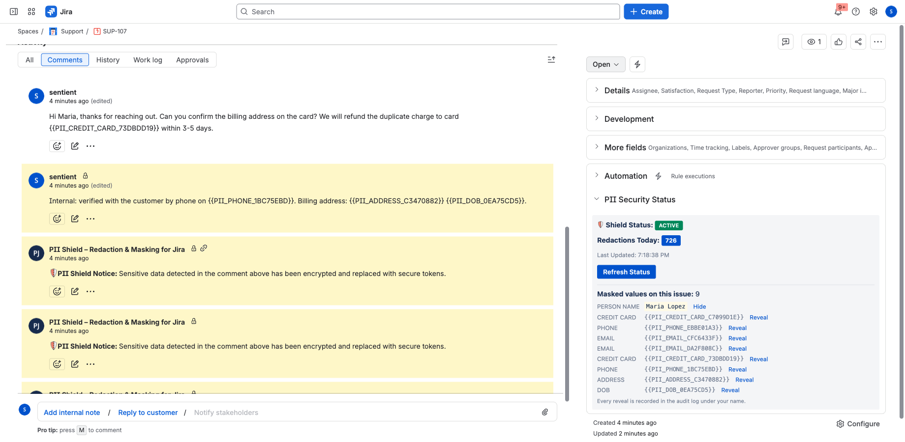
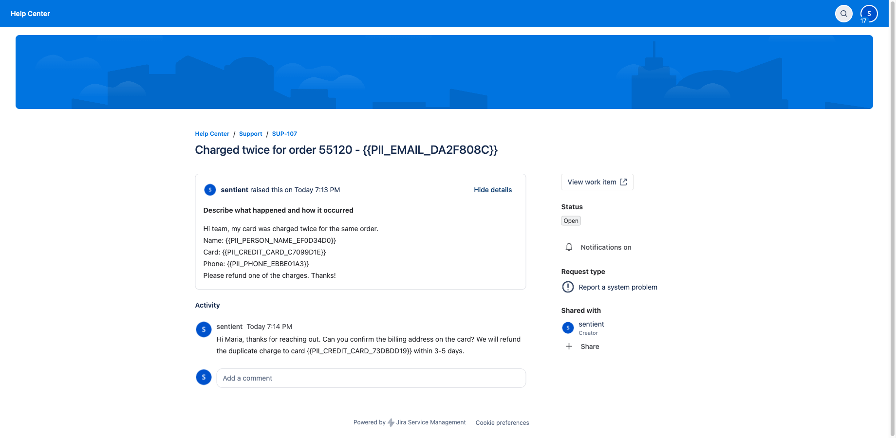
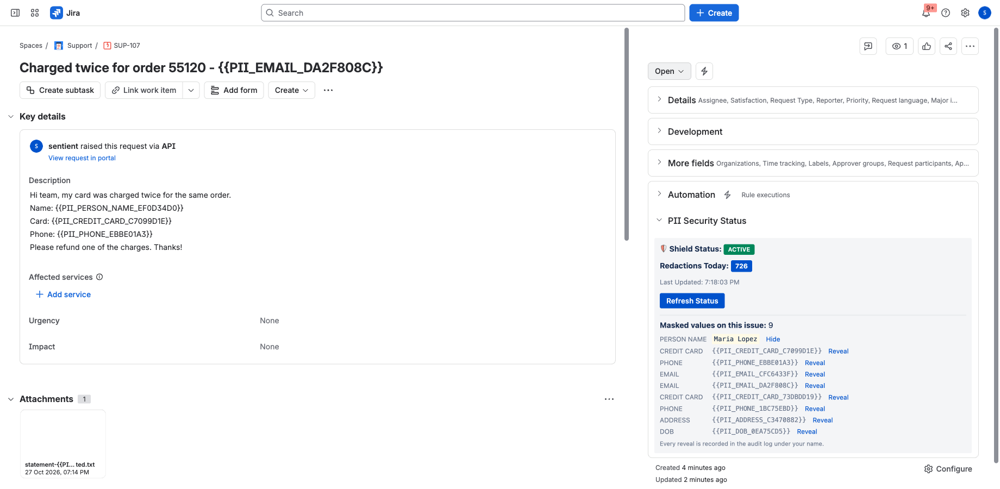
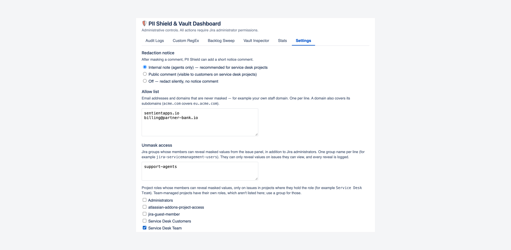
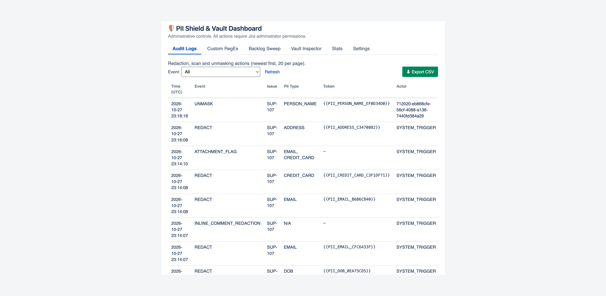

# PII Shield – User Documentation & Security Policy

**Developed by SentientApps** *Empowering Jira Admins with privacy-first automated security.*

---

## 🛡️ Overview
**PII Shield for Jira** automatically detects and redacts Personally Identifiable Information (PII) and secrets from Jira **issue fields, comments, worklogs, links and text attachments** — replacing them in place with secure, reversible tokens. It runs **100% natively on Atlassian Forge** and is designed for high-compliance environments (GDPR, CCPA, SOC 2).

## 🎬 Demo Video
A 90-second narrated screen recording of version 3.3 with synthetic data: a customer raises a request with personal details, PII Shield masks it within seconds, an agent's internal note is masked with an internal notice, an allowed agent reveals a value, the customer portal shows only tokens, and the admin settings and audit log.

▶️ **[Watch the demo (MP4)](media/pii-shield-3.3-demo.mp4)**

**Feature tour (3 minutes, narrated)** — everything PII Shield covers, in eight chapters: the service desk (portal requests, internal notes, what customers see); developers (API keys and secrets masked, code blocks left as written); the whole issue (summary, description, labels, Environment, custom fields, request-form answers, worklogs, web links); attachments (text files rewritten, file names masked, PDF and Office files flagged); reveal by group or project role; settings (detection types, notices, allow list, custom rules); cleaning up existing data with a Backlog Sweep; and the admin tools (Vault Inspector, Stats, audit log with CSV export).

▶️ **[Watch the feature tour on YouTube](https://youtu.be/CSt1eDZoFaY)** · [download the MP4](media/pii-shield-3.3-feature-tour.mp4)

## 📸 Screenshots

Taken on version 3.3 with synthetic data.

**Agent view** — personal data in comments is masked in place within seconds. PII Shield's notice is an internal note, and the panel shows the issue's masking status.

**Customer portal** — customers see tokens, never the original values or PII Shield's internal notes.

**Reveal from the issue panel** — agents in allowed groups or project roles reveal a value; every reveal is logged under their name.

**Settings** — the notice as an internal note, a public comment or off; an allow list for your own domains; and which groups and project roles can reveal.

**Audit log** — every redaction, reveal and flag, exportable to CSV for SOC 2 and GDPR evidence.

## 🚀 How to Access the App
Once installed from the Atlassian Marketplace:
1. **Real-time protection** runs automatically on issues, comments, worklogs, links and attachments as they are created or updated — no configuration required. Comments added through the customer portal, email or the API are masked within seconds, without anyone opening the ticket.
2. **Admin dashboard:** go to **Jira Settings → Apps → PII Shield** to reach the *PII Shield & Vault Dashboard*.
3. **Issue panel:** each issue shows the masking status (Active, Retrying or Needs attention) and lets permitted agents reveal values.

## 🛠️ How it Works
PII Shield scans text in real time and, when it finds sensitive data, encrypts it and replaces it with a token such as `{{PII_EMAIL_2D2D363E}}`. A short notice is added so the team knows masking occurred — an internal note by default, or a public comment, or no notice (see **Settings**). If a write fails, it is retried automatically.

**Detected out of the box:**
* **Email addresses**
* **Phone numbers**, including international formats
* **Credit-card numbers** (Luhn-validated) and **US Social Security numbers**
* **Labelled personal details** — names, postal addresses and dates of birth that follow a label such as `Name:`, `Address:` or `DOB:`
* **Technical secrets / API keys** — AWS, Stripe, GitHub, Google, Slack, Twilio, SendGrid, npm, and Bearer tokens
* **Custom patterns** — any regular expression you add under **Custom RegEx**

Values split by formatting (for example, part bold) and full-width or non-Latin digits are still caught.

**Where it masks:** summaries, descriptions, the Environment field, labels, custom fields, request-form answers, comments, worklog comments, web links, attachment file names, link targets and smart links, and text attachments. **PDF and Office attachments** are scanned and flagged when they contain personal data, but not changed. **Code blocks are preserved**, so developer snippets and logs stay intact.

### Admin Dashboard
* **Audit Logs** — every redaction, scan, and unmask, exportable to CSV for SOC 2 / GDPR evidence.
* **Custom RegEx** — add organization-specific patterns (e.g. `EMP-\d{6}`); every match is treated as PII.
* **Backlog Sweep** — tokenize legacy PII across a project's existing issues.
* **Vault Inspector** — a Jira admin can unmask a token for an investigation; every unmask is audited.
* **Stats** — redaction metrics.
* **Settings** — turn detection types on or off, keep an **allow list** of your own addresses and domains (wildcards supported), choose how the notice is posted, and choose which **groups or project roles** may reveal values in the issue panel.

---

## 🔒 Security Policy
The following sections outline our commitment to data protection and our "Zero-Egress" architecture.

### Atlassian Forge Infrastructure
PII Shield is built exclusively on the **Atlassian Forge** platform. The app operates within a multi-tenant, serverless environment managed and secured by Atlassian, inheriting Atlassian's enterprise-grade security controls, including built-in authentication, scoped permissions, and data isolation.

### Zero-Egress Architecture
* **No external data transfer:** No end-user data — Jira issue content, comments, attachments, or metadata — is ever transmitted to or stored on servers outside Atlassian. The app declares **no external egress** in its manifest, and Forge enforces this.
* **In-platform processing:** All detection and redaction logic runs inside the Atlassian Forge FaaS environment. The app uses **no third-party subprocessors**.

### Data Storage & Retention
* **Stored within Atlassian only** — using Forge Key-Value Store and Forge SQL. No external database.
* **Encrypted vault:** so that redactions can be reversed by an authorized admin, the original value is encrypted with **AES-256-GCM** and stored as **ciphertext**, keyed to its token. **Plaintext PII is never stored** — only ciphertext, revealable only by Jira administrators and the groups or project roles an admin allows; every reveal is logged.
* **Metadata & audit** (redaction counts, and an audit trail of event type, token, issue key, timestamp, and actor) are stored in Forge storage and contain no plaintext PII.
* **Deletion:** an issue's stored values are erased when the issue is deleted, and all app data is removed when the app is uninstalled, per Atlassian's Forge data-lifecycle handling.

### Encryption
* **In transit:** TLS, within the Atlassian platform.
* **At rest:** AES-256-GCM for vaulted values, on top of Atlassian's own storage encryption.

### Permissions and data handling
PII Shield requests only these Jira permissions:

| Permission | Why PII Shield needs it |
|---|---|
| Read Jira work (`read:jira-work`) | Read issue fields, comments, worklogs, web links and attachments to find personal data, and receive change events. |
| Write Jira work (`write:jira-work`) | Write the masked text back, replace an attachment with its masked copy, and add an internal notice. It never deletes issues. |
| Read Jira users (`read:jira-user`) | Check admin, group and project-role membership before a reveal. |
| App storage (`storage:app`) | Store encrypted originals, settings, rules, masking status and the audit log, inside Atlassian. |
| Personal data reporting (`report:personal-data`) | Report account IDs held in the audit log to Atlassian, and erase closed accounts. |

* **No outside calls:** the app declares no external domains, so Forge prevents any data leaving Atlassian.
* **What is stored:** encrypted originals of masked values, settings (including your allow list), custom rules, masking status, and an audit log of event type, issue, token, time and the acting account ID.
* **Deletion:** an issue's stored values are erased when the issue is deleted; all app data is deleted when the app is uninstalled.
* **Known limits:**
  * Jira's issue History, and the emails Jira sends when an issue is created, commented on or given an attachment, keep the original text, because Jira writes them before any app can act.
  * PII Shield's own masking edits don't send update emails (version 3.1 and later). One exception: Jira can't rename a file, so when a file name holds personal data PII Shield uploads a copy under a masked name and deletes the original, and Jira's update email lists the deleted original by its name. Jira offers apps no way to make that change silently.
  * PDF and Office files are scanned and flagged but not changed.

### Vulnerability Reporting
If you discover a potential vulnerability, please report it via our [Issue Tracker](https://github.com/sentientapps/pii-shield-support/issues) or by emailing **support@sentientapps.io**. We aim to acknowledge security reports within 24 business hours.

---

## 📞 Support & Feedback
* **Support Email:** [support@sentientapps.io](mailto:support@sentientapps.io)
* **Marketplace Listing:** [PII Shield – Redaction & Masking for Jira on the Atlassian Marketplace](https://marketplace.atlassian.com/apps/2061532770)
* **Bug Reports:** open an issue on our [GitHub Support Repository](https://github.com/sentientapps/pii-shield-support).

---
*© 2026 SentientApps. Built for the Atlassian Marketplace.*
